# Record hand data with the Hand Capture sample

Record hand data on your XR device to use as the basis for custom hand shapes.

The **Hand Capture** sample is a scene that you build and run on your XR device. Its in-headset interface lets you record, name, and manage hand recordings. After you record, you import the recordings into the Unity Editor, where you can create [`XRHandShape`](xref:xrhands-hand-shapes) assets from them.

## Prerequisites

* Use Unity 7000.0 or newer.
* [Install XR Hands](xref:xrhands-install) version 7.0.0-pre.1 or newer.
* Install the [OpenXR Plugin](https://docs.unity3d.com/Packages/com.unity.xr.openxr@latest?subfolder=/manual/index.html) package (`com.unity.xr.openxr`) version 7.0.0-pre.1 or newer.
* Connect an Android-based XR device that supports hand tracking with OpenXR, such as a Meta Quest device, to your computer.

## Set up the sample

Import the sample and its dependencies, then configure your project for hand tracking with OpenXR.

### Import the sample and its dependencies

To import the Hand Capture sample and the packages and samples it depends on:

1. Go to **Window** > **Package Manager**, and select the **XR Hands** package.
1. In the **Samples** tab, import the **Hand Capture** sample and the **HandVisualizer** sample.
1. Install the following packages, if your project doesn't already have them:

    * [XR Interaction Toolkit](https://docs.unity3d.com/Packages/com.unity.xr.interaction.toolkit@latest?subfolder=/manual/index.html) (`com.unity.xr.interaction.toolkit`) version 7.0.0-pre.1 or newer.
    * Unity UI (`com.unity.ugui`) version 2.0.0 or newer, which includes [TextMesh Pro](https://docs.unity3d.com/Packages/com.unity.ugui@latest?subfolder=/manual/TextMeshPro/index.html).

1. Select the **XR Interaction Toolkit** package, and in the **Samples** tab, import the following samples:

    * [Starter Assets](https://docs.unity3d.com/Packages/com.unity.xr.interaction.toolkit@latest?subfolder=/manual/samples-starter-assets.html)
    * [Hands Interaction Demo](https://docs.unity3d.com/Packages/com.unity.xr.interaction.toolkit@latest?subfolder=/manual/samples-hands-interaction-demo.html)
    * [Spatial Keyboard](https://docs.unity3d.com/Packages/com.unity.xr.interaction.toolkit@latest?subfolder=/manual/samples-spatial-keyboard.html)

    > [!IMPORTANT]
    > If you upgrade XR Interaction Toolkit samples in place from an older version, script references in the demo scenes become disconnected. Before you import newer XR Interaction Toolkit samples, delete the existing XR Interaction Toolkit sample folders from `Assets/Samples`.

1. Go to **Window** > **TextMeshPro** > **Import TMP Essential Resources**, and import the resources.

Your project now contains the Hand Capture sample and the packages and samples listed in these steps.

You can also resolve these dependencies from **Project Validation**. Go to **Edit** > **Project Settings** > **XR Plug-in Management** > **Project Validation**, and select **Fix** next to each issue that starts with **[XR Hand Capture Sample]**. If XR Interaction Toolkit is missing or older than 7.0.0-pre.1, **Fix** installs version 7.0.0-pre.1. For the TMP Essential Resources issue, select **Edit**, then select **Import TMP Essentials** in the window that opens.

### Configure project settings

To configure your project for hand tracking with OpenXR:

1. Go to **Edit** > **Project Settings** > **XR Plug-in Management**, and enable the **OpenXR** plug-in provider.

    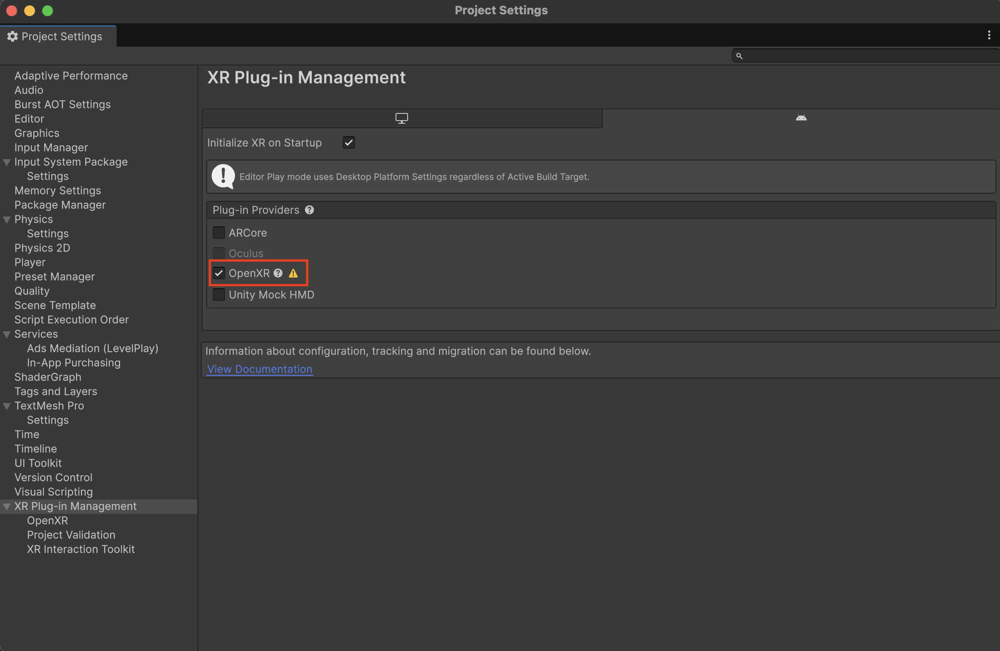

1. Go to **Edit** > **Project Settings** > **XR Plug-in Management** > **OpenXR**, and under **OpenXR Feature Groups**, enable the [Hand Tracking Subsystem](xref:xrhands-openxr-hands-feature) feature. Enabling the OpenXR plug-in provider doesn't enable this feature.
1. If you build for Meta Quest devices, also enable the **Meta Quest Support** feature, which is available only in the **Android** tab, and the **Meta Hand Tracking Aim** feature. Then, in the same window, add an **Interaction Profile**, such as the **Oculus Touch Controller Profile**, for controller support.

    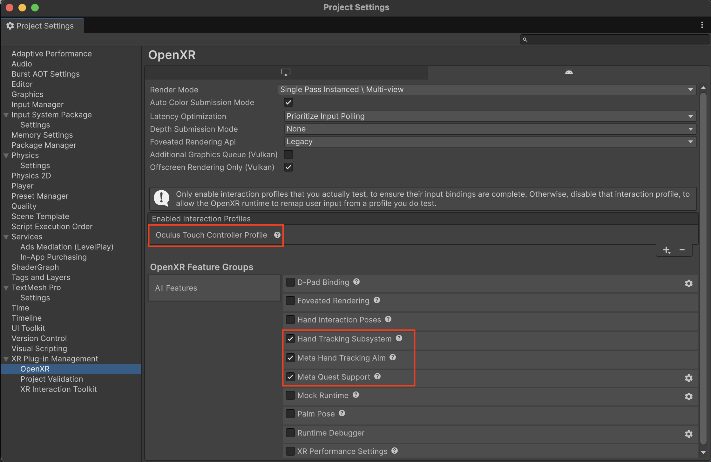

Your project now uses the OpenXR plug-in provider with the Hand Tracking Subsystem feature enabled.

## Build and run the sample

To build the sample and run it on your device:

1. Open the sample scene at `Assets/Samples/XR Hands/<version>/Hand Capture/HandCapture.unity`, where `<version>` is the version of XR Hands in your project.

    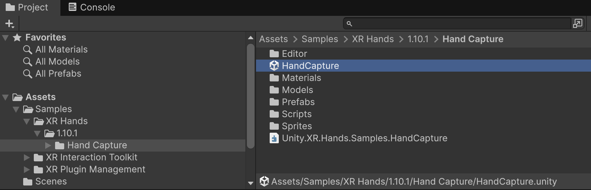

1. Go to **File** > **Build Profiles**, select **Scene List**, and then select **Add Open Scenes** to add the sample scene.

    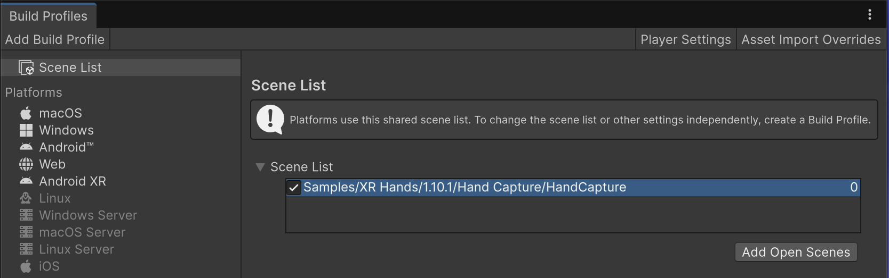

1. In the **Platforms** list, select the platform for your XR device. If it isn't the active platform, select **Switch Platform**.
1. Select **Build And Run** to build the app and run it on your connected device.

The sample app now runs on your device. To make a recording, follow the steps in [Record hand data](#record-hand-data).

## Record hand data

When the app starts on your device, an in-headset interface guides you through recording. For the best results, record with your palm facing the camera, so that the device captures finger detail.

To record hand data:

1. Select **Start**. To read detailed instructions first, select **See Steps**.

    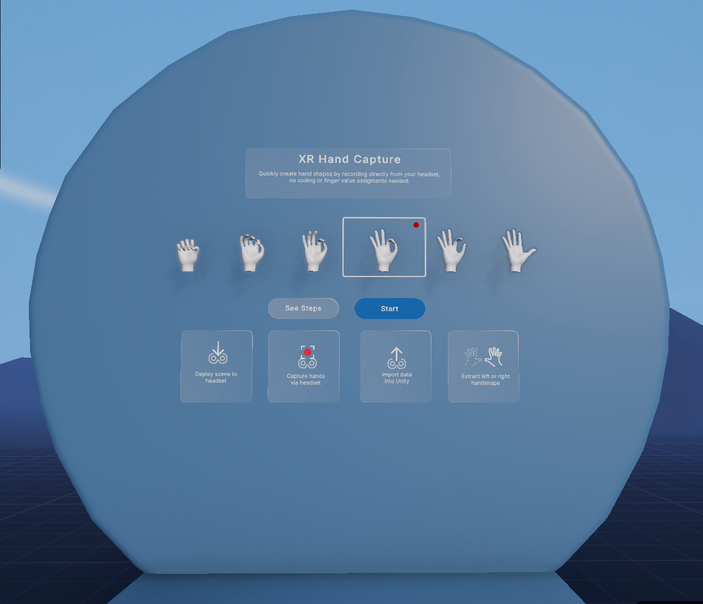

1. Select **Record**. The panel shows which recording slot the recording uses, for example **Recording Slot 1/5**.

    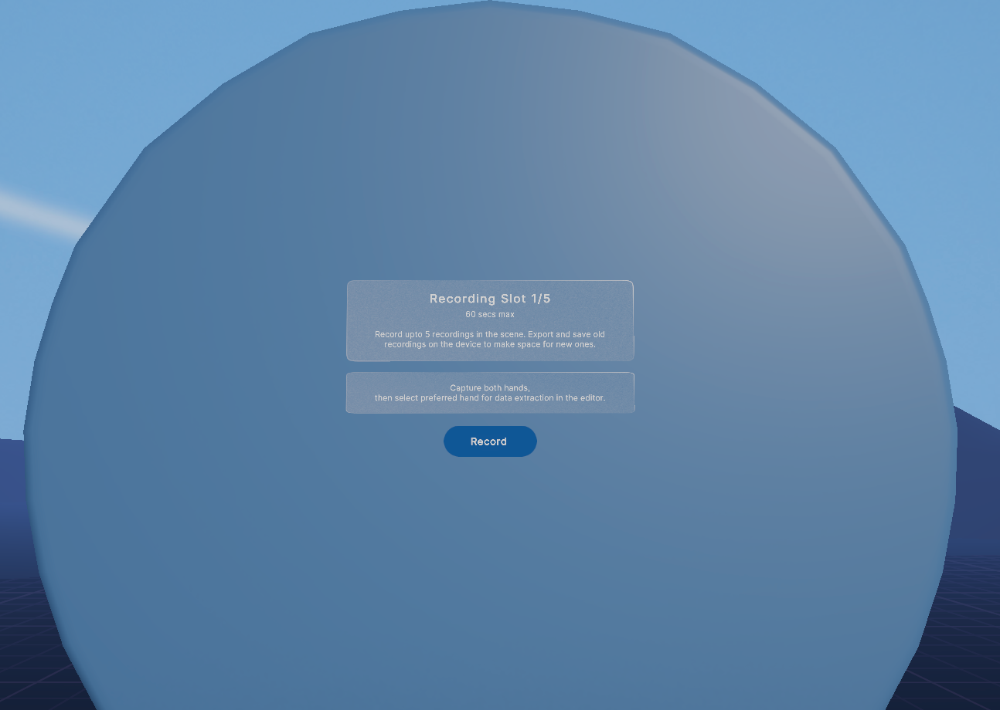

1. When you're done, select **Stop**. The panel shows a progress bar and a timer, and recording stops automatically after 60 seconds.

    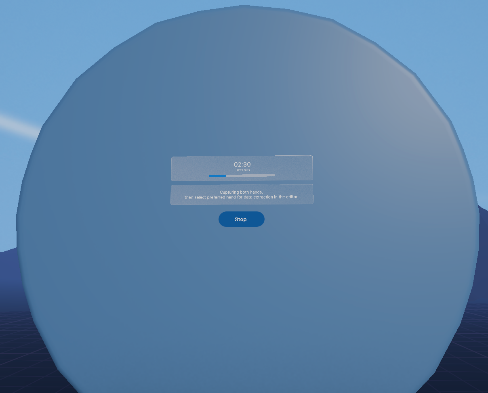

1. Enter a name for the recording or keep the default name, then select **Save**. To discard the recording, select **Discard**.

    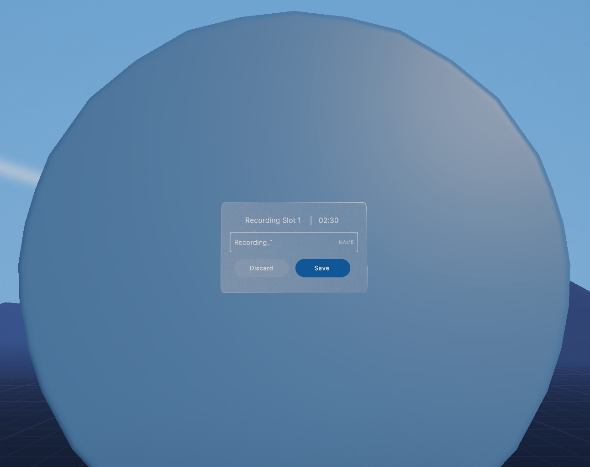

After you save a recording, the app lists your saved recordings under **Saved Recordings**. From there, you can delete a recording with its delete icon, or select **Record Another** to start a new recording if a slot is free.

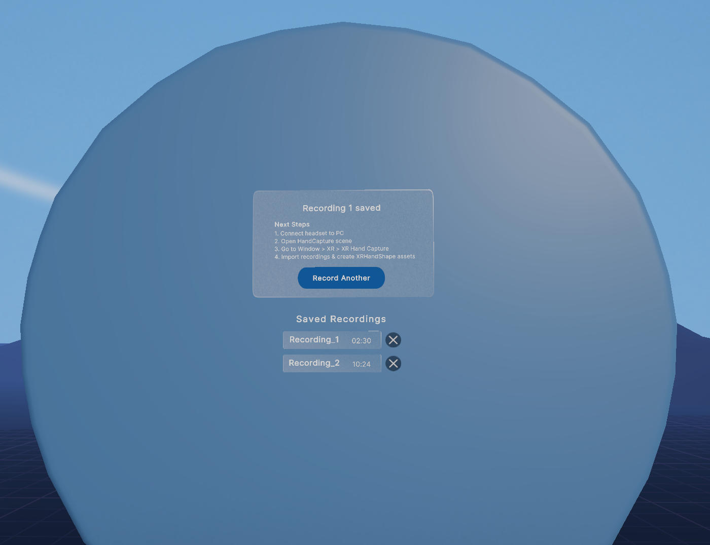

## Recording storage on the device

The sample stores recordings on the device as follows:

* The sample provides five recording slots, and each slot holds up to 60 seconds of hand data. The sample assigns the next free slot to each new recording.
* When all slots are full, you can't make new recordings. To free a slot, import the recordings into the Editor, then delete them from the device.
* Recordings persist after you close and reopen the app. They're removed only when you delete them in the app, or when you uninstall the app.
* The sample names recordings `Recording_1`, `Recording_2`, and so on. When you reopen the app, the numbering continues from the highest number in earlier sessions. To restart the numbering at 1, delete all recordings and restart the app.

To keep device storage free, delete recordings that you no longer need.

## Import recordings into the Editor

After you record hand data, import the recordings into the Unity Editor. In the Editor, you can review the captured data, select a hand shape, and create new [`XRHandShape`](xref:xrhands-hand-shapes) assets from it. For instructions, refer to [Generate XRHandShape assets from hand recordings](xref:xrhands-xrhandcapture-playback).

## Troubleshooting

If the sample shows errors after you import it, use the following sections to identify and fix the problem.

### Missing dependencies

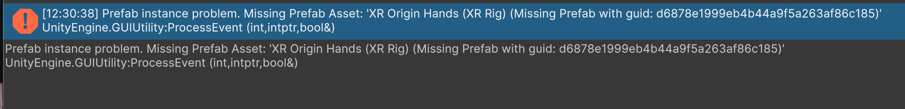

These errors occur when you haven't imported the samples that the Hand Capture sample depends on. After you import the missing samples, the errors clear. To check what's missing, go to **Edit** > **Project Settings** > **XR Plug-in Management** > **Project Validation**:

* If your project doesn't have the XR Interaction Toolkit package, select **Fix** to install it.

    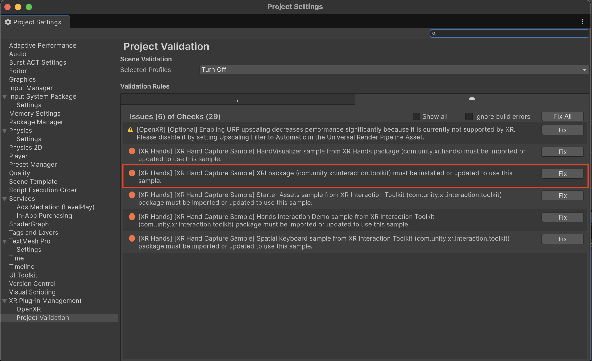

* If you haven't imported the **Starter Assets**, **Hands Interaction Demo**, or **Spatial Keyboard** samples from XR Interaction Toolkit, select **Fix** to import each one.

    > [!IMPORTANT]
    > If you upgrade XR Interaction Toolkit samples in place from an older version, script references in the demo scenes become disconnected. Before you import newer XR Interaction Toolkit samples, delete the existing XR Interaction Toolkit sample folders from `Assets/Samples`.

    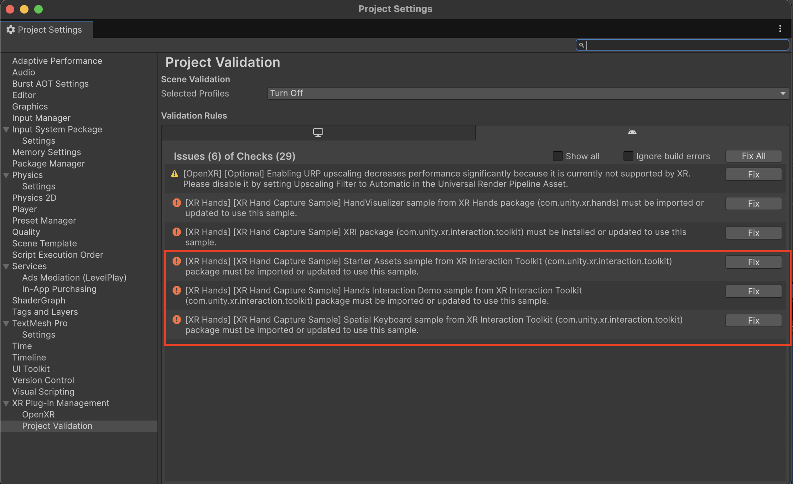

* If you haven't imported the **HandVisualizer** sample from XR Hands, select **Fix** to import it.

    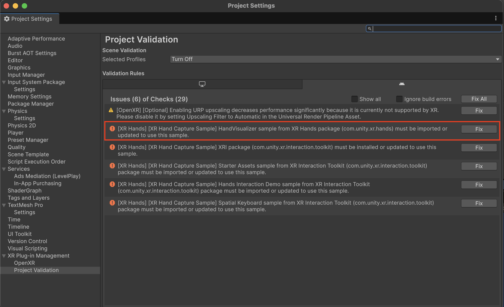

### Incorrect scene appearance

If the sample scene shows pink or missing materials, your project doesn't use the Universal Render Pipeline (URP). The XR Hands samples support only URP.

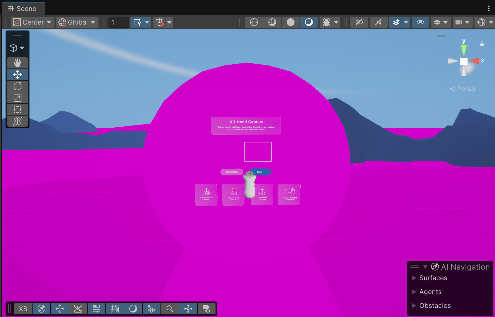

To fix this, install and configure URP in your project. For more information, refer to [Install and configure URP](https://docs.unity3d.com/Manual/urp/InstallingAndConfiguringURP.html). If your project uses the Built-In Render Pipeline, refer to [Migrating from the Built-In Render Pipeline to URP](https://docs.unity3d.com/Manual/urp/upgrading-from-birp.html).

## Additional resources

* [Generate XRHandShape assets from hand recordings](xref:xrhands-xrhandcapture-playback)
* [Hand shape](xref:xrhands-hand-shapes)
* [Custom gestures](xref:xrhands-custom-gestures)
* [Hand Tracking Subsystem OpenXR feature](xref:xrhands-openxr-hands-feature)
