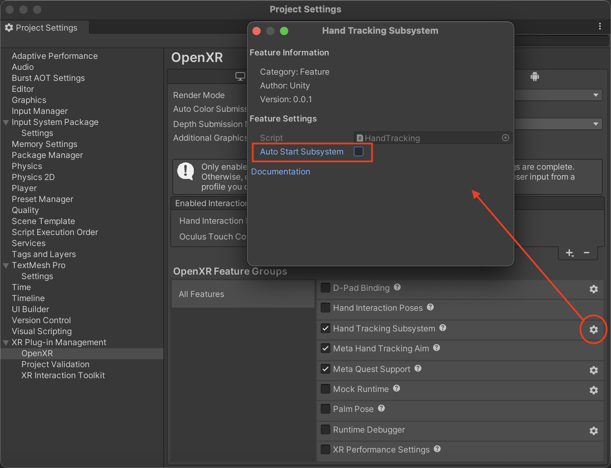

# Hand Tracking Subsystem OpenXR feature

Access hand tracking data from an OpenXR runtime through the XR Hands package.

The **Hand Tracking Subsystem** feature enables the [`XR_EXT_hand_tracking`](https://registry.khronos.org/OpenXR/specs/1.1/html/xrspec.html#XR_EXT_hand_tracking) OpenXR extension, and creates and manages an [`XRHandSubsystem`](xref:UnityEngine.XR.Hands.XRHandSubsystem) for you. You must enable this feature to access any hand tracking data with OpenXR. The other OpenXR features in XR Hands also require it.

To receive updates from the subsystem, subscribe to the [`XRHandSubsystem.updatedHands`](xref:UnityEngine.XR.Hands.XRHandSubsystem.updatedHands) event. For more information, refer to [Access hand data](xref:xrhands-access-data).

## Prerequisites

To use the Hand Tracking Subsystem feature, your project must meet the following requirements:

* Install the [OpenXR Plugin package](https://docs.unity3d.com/Packages/com.unity.xr.openxr@latest). To deploy to Meta Quest devices, use version 1.6.0 or newer. Hand tracking doesn't work on Meta Quest devices with older versions of the OpenXR Plugin package.
* [Enable the OpenXR plug-in provider](xref:xr-configure-providers) in **XR Plug-in Management** for each platform you build for. Enabling the plug-in provider doesn't enable hand tracking. You must also enable this feature, as described in [Enable the feature](#enable-the-feature).

## Enable the feature

To enable the Hand Tracking Subsystem feature:

1. Go to **Edit** > **Project Settings** > **XR Plug-in Management** > **OpenXR**.
1. Select the tab for the platform you build for.
1. Under **OpenXR Feature Groups**, enable **Hand Tracking Subsystem**.

The feature now creates and manages the `XRHandSubsystem` for your app. To control when it creates the subsystem, use the **Auto Start Subsystem** setting.

OpenXR settings are separate for each platform. If you build for more than one platform, enable the feature in each platform's tab.

## Android manifest entries

You don't need to edit the Android manifest for hand tracking. When you build for Android, Unity adds the entries that hand tracking needs:

* **Meta Quest**: If you enable the [Meta Quest Support](xref:openxr-meta-quest-support) feature, XR Hands adds the `com.oculus.permission.HAND_TRACKING` permission, and declares `oculus.software.handtracking` as an optional device feature (`required="false"`).
* **Android XR**: If you enable the **Android XR** feature group, the [Unity OpenXR: Android XR](https://docs.unity3d.com/Packages/com.unity.xr.androidxr-openxr@latest) package adds the `android.permission.HAND_TRACKING` permission. Your app must also request this permission from the user at runtime. For more information, refer to [Hand tracking](https://docs.unity3d.com/Packages/com.unity.xr.androidxr-openxr@latest?subfolder=/manual/features/hand-tracking.html) in the Android XR documentation.

## Feature settings

To access the feature settings, select the gear icon next to **Hand Tracking Subsystem** in **Edit** > **Project Settings** > **XR Plug-in Management** > **OpenXR**.

 *Hand Tracking Subsystem feature settings*

| Property | Description |
| :------- | :---------- |
| **Auto Start Subsystem** | Create and start the `XRHandSubsystem` automatically when the OpenXR session starts. Enabled by default. Disable this setting to start hand tracking later, for example after the user grants a permission that hand tracking requires. When this setting is disabled, Unity doesn't create the subsystem until you enable an [OpenXR Hand Subsystem Manager](xref:xrhands-openxr-subsystem-manager) component or call [`HandTracking.EnsureSubsystemInitialized`](xref:UnityEngine.XR.Hands.OpenXR.HandTracking.EnsureSubsystemInitialized*). For more information, refer to [Deferred initialization](xref:xrhands-openxr-subsystem-manager#deferred-initialization). |

## Access the subsystem from scripts

The [`HandTracking`](xref:UnityEngine.XR.Hands.OpenXR.HandTracking) class provides static members to access the hand subsystem that this feature manages, and to control when the feature creates it:

| Member | Description |
| :----- | :---------- |
| [`subsystem`](xref:UnityEngine.XR.Hands.OpenXR.HandTracking.subsystem) | The `XRHandSubsystem` that this feature creates. Valid only while the feature is enabled and running. |
| [`subsystemCreated`](xref:UnityEngine.XR.Hands.OpenXR.HandTracking.subsystemCreated) | Invoked when the feature creates the `XRHandSubsystem`. |
| [`destroyingSubsystem`](xref:UnityEngine.XR.Hands.OpenXR.HandTracking.destroyingSubsystem) | Invoked just before the feature destroys the `XRHandSubsystem`. |
| [`automaticallyInitializeSubsystem`](xref:UnityEngine.XR.Hands.OpenXR.HandTracking.automaticallyInitializeSubsystem) | Overrides the **Auto Start Subsystem** setting at runtime. Set it in a `static` method marked with `[RuntimeInitializeOnLoadMethod(RuntimeInitializeLoadType.SubsystemRegistration)]`. |
| [`EnsureSubsystemInitialized`](xref:UnityEngine.XR.Hands.OpenXR.HandTracking.EnsureSubsystemInitialized*) | Creates the `XRHandSubsystem` if it doesn't exist yet, and starts it if the OpenXR session is running. |

## Additional resources

* [OpenXR Hand Subsystem Manager component](xref:xrhands-openxr-subsystem-manager)
* [Access hand data](xref:xrhands-access-data)
* [OpenXR features](xref:xrhands-openxr-features)
