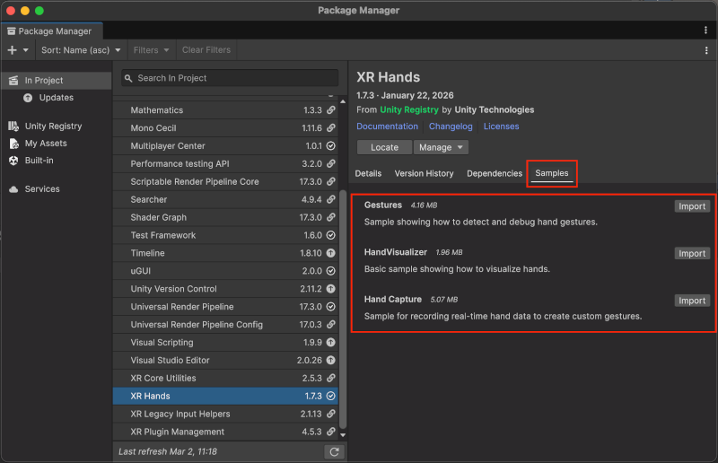
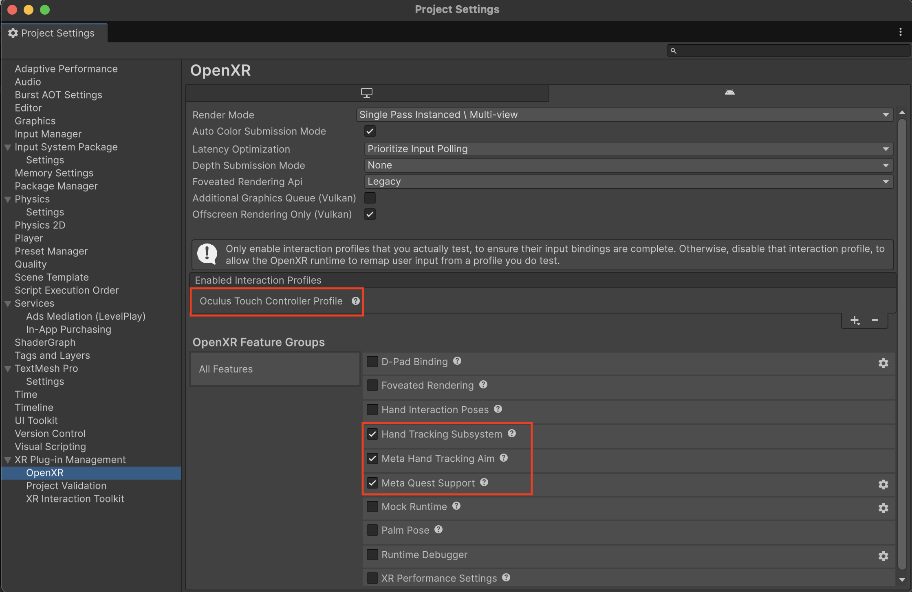

# Scene setup

The quickest way to get started with hand tracking is to use the scene included in the [HandVisualizer sample](xref:xrhands-manual#samples). This sample provides a fully functional hand-tracking scene with hand mesh visualization, debug joints, and all required components already configured.

Import the **HandVisualizer** sample for the XR Hands package using the [Package Manager](https://docs.unity3d.com/Manual/upm-ui-import.html), then open the **HandVisualizer** scene.

 *Import the HandVisualizer sample from the Package Manager*

## Set up a new scene

To add hand tracking to a new scene from scratch, complete the following steps.

### Prerequisites

- [Install XR Hands](xref:xrhands-install).
- [Enable XR providers](xref:xr-configure-providers) for the devices that you plan to support.

### Add an XR Origin

Add an [XR Origin](https://docs.unity3d.com/Packages/com.unity.xr.core-utils@latest?subfolder=/manual/xr-origin.html) to your scene if one doesn't already exist. For VR hand-tracking apps, use the **XR Origin (VR)** provided by the [XR Interaction Toolkit](https://docs.unity3d.com/Packages/com.unity.xr.interaction.toolkit@latest?subfolder=/manual/index.html).

### Add hand visualization

1. Import the **HandVisualizer** sample from XR Hands.
2. In the **Project** window, navigate to **Assets** &gt; **Samples** &gt; **XR Hands** &gt; **&lt;version&gt;** &gt; **HandVisualizer** &gt; **Prefabs**.
3. Drag the **Hand Debug Visualizer** prefab into the **Hierarchy** window as a child of the **Camera Offset** GameObject under the **XR Origin**.
4. Select the **Hand Debug Visualizer** GameObject and make sure its **Transform** position is **(0, 0, 0)** in the **Inspector**.

    > [!IMPORTANT]
    > The Hand Debug Visualizer's local position must be **(0, 0, 0)** relative to the **Camera Offset** GameObject. A non-zero offset causes the rendered hands to be misaligned with the user's real hand positions.

After completing the setup, your **Hierarchy** window should contain the following structure:

* **XR Origin**
    * **Camera Offset**
        * **Main Camera**
        * **Hand Debug Visualizer**

 *Scene hierarchy with XR Origin and Hand Debug Visualizer*

### Enable hand tracking

To enable hand tracking with OpenXR, open **Edit** &gt; **Project Settings** &gt; **XR Plug-in Management** &gt; **OpenXR** and enable the [Hand Tracking Subsystem](xref:xrhands-openxr-hands-feature) feature under **OpenXR Feature Groups**.

For other provider plug-ins, check the documentation for that plug-in for hand-tracking configuration steps.

### Build for Meta Quest with OpenXR {#meta-quest-support-via-openxr}

To build for Meta Quest devices, complete the following steps in addition to [enabling hand tracking](#enable-hand-tracking):

1. In the **Android** tab of **Edit** &gt; **Project Settings** &gt; **XR Plug-in Management** &gt; **OpenXR**, enable the [Meta Quest Support](xref:openxr-meta-quest-support) feature.
1. Add an **Interaction Profile**, such as the [Oculus Touch Controller Profile](xref:openxr-oculus-touch-controller-profile), for controller support.

 *OpenXR project settings configured for Meta Quest with hand tracking*

Your OpenXR settings now include Meta Quest support and controller input.

### Build for Android XR with OpenXR

To build for Android XR devices, complete the following steps:

1. Install the [Unity OpenXR: Android XR](https://docs.unity3d.com/Packages/com.unity.xr.androidxr-openxr@latest) package, and enable the **Android XR** feature group in the **Android** tab of **Edit** &gt; **Project Settings** &gt; **XR Plug-in Management** &gt; **OpenXR**. This feature group includes the **Android XR Support** feature. For detailed steps, refer to [Configure project settings](https://docs.unity3d.com/Packages/com.unity.xr.androidxr-openxr@latest?subfolder=/manual/get-started/project-setup.html) in the Android XR documentation.
1. In the same **Android** tab, make sure the [Hand Tracking Subsystem](xref:xrhands-openxr-hands-feature) feature is enabled. The **Android XR** feature group doesn't include this feature, so enabling the group doesn't enable hand tracking.
1. Add an **Interaction Profile** for each type of input your app supports, such as the [Hand Interaction Profile](xref:openxr-hand-interaction-profile) for hand input or the [Oculus Touch Controller Profile](xref:openxr-oculus-touch-controller-profile) for controller input. OpenXR Project Validation shows a warning if you don't enable an **Interaction Profile**.
1. In your app, request the `android.permission.HAND_TRACKING` permission from the user at runtime. Unity adds this permission to the Android manifest when you build, but your app doesn't receive hand tracking data until the user grants the permission. For example code, refer to [Hand tracking](https://docs.unity3d.com/Packages/com.unity.xr.androidxr-openxr@latest?subfolder=/manual/features/hand-tracking.html) in the Android XR documentation.

To start hand tracking only after the user grants the permission, use [deferred initialization](xref:xrhands-openxr-subsystem-manager#deferred-initialization).

## Additional resources

* [Hand tracking data](xref:xrhands-tracking-data): details about accessing and using hand-tracking data.
* [Custom gestures](xref:xrhands-custom-gestures): information about creating custom gestures for your project.
* [Install XR Hands](xref:xrhands-install): setup and installation instructions.
